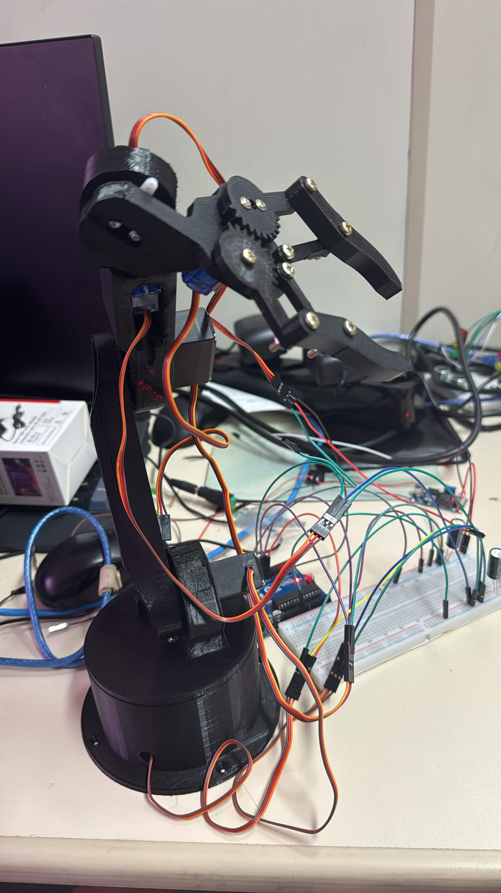

<p align="center">
  
</p>

# Braço Robótico 6 Eixos — Controle pelo PC

<!-- FOTO PRINCIPAL: salve a foto do braço montado como docs/images/braco.jpg -->
<p align="center">
  
</p>
<p align="center">
  <video src="images/CE313A71-366F-4B98-AA2D-FC6CEABA50F6.mov"
         width="420"
         controls></video>
</p>
Braço robótico de **6 graus de liberdade** impresso em 3D e controlado pelo computador via USB. A parte mecânica vem do projeto aberto [MasterJain/RoboticArm](https://github.com/MasterJain/RoboticArm); em cima dela foram refeitos a **alimentação dos servos**, o **firmware do Arduino** e um **programa em Python/Tkinter** para mover cada junta, gravar sequências de movimento e reproduzi-las.

O projeto original era controlado por um aplicativo Bluetooth no celular. Esta versão troca o Bluetooth pelo cabo USB e permite controlar e programar o braço inteiro pela interface, sem digitar comandos.

[Firmware do Arduino](firmware/braco_pc/braco_pc.ino) · [Programa de controle](app/controle_braco.py) · [Sequência de exemplo](app/acenar.json)

## O que o programa permite fazer

- Mover cada uma das 6 juntas (base, ombro, cotovelo, punho, giro da garra e garra) por sliders, em tempo real.
- Ajustar a velocidade dos movimentos, de 1 (lento) a 10 (rápido).
- Gravar posições, montar uma sequência e reproduzi-la com repetições e pausa entre as posições.
- Salvar sequências com nome; os arquivos `.json` da pasta aparecem como botões e **um clique já reproduz**.
- Encontrar o Arduino sozinho ao abrir e reconectar se o cabo USB for desconectado.
- Respeitar os limites de cada junta, para nenhum servo forçar contra a estrutura.

<!-- PRINT DO PROGRAMA: salve como docs/images/programa.png -->


*Os sliders mostram a posição atual de cada junta. As sequências salvas na pasta do programa aparecem em "Sequências salvas".*

<!-- GIF/VÍDEO: grave o braço acenando e salve como docs/images/acenando.gif
     (ou edite este README no GitHub e arraste o .mp4 aqui; ele vira um vídeo na página) -->
<p align="center">
  
</p>

## Requisitos e materiais

### Peças

| Peça | Qtd. | Observação |
| --- | --- | --- |
| Arduino Uno | 1 | Alimentado somente pelo USB |
| Servo MG996R | 3 | Base, ombro e cotovelo |
| Servo SG90 | 3 | Punho, giro da garra e garra |
| Regulador step-down LM2596 | 2 | Cada um regulado em **5,0 V** |
| Fonte 12 V | 1 ou 2 | 12 V 3 A recomendada |
| Borne P4 fêmea | 1 ou 2 | Liga o plugue da fonte sem cortar o cabo |
| Chave gangorra | 1 | Liga e desliga a energia dos servos |
| Capacitor eletrolítico | 2 | 1000 a 2200 µF, 16 V ou mais, um por trilho |
| Protoboard e jumpers | — | Uma placa soldada é mais confiável |
| Peças impressas em 3D | — | STL no [repositório original](https://github.com/MasterJain/RoboticArm) |
| Multímetro | 1 | Necessário para regular os LM2596 |

### Software

O projeto foi usado em **Ubuntu**, com:

| Componente | Versão ou requisito |
| --- | --- |
| Arduino IDE | Para enviar o firmware (biblioteca `Servo`, já inclusa na IDE) |
| Python | 3.8 ou mais recente |
| Tkinter | `python3-tk` no Ubuntu; já vem no Python do Windows |
| pyserial | `pip install -r app/requirements.txt` |

## Montagem do circuito

<!-- FOTO DO CIRCUITO: salve como docs/images/circuito.jpg -->


### 1. Alimentação

```text
Fonte 12 V ──► chave ──► LM2596 nº 1 (5,0 V) ──► trilho A ──► 3× MG996R
Fonte 12 V ────────────► LM2596 nº 2 (5,0 V) ──► trilho B ──► 3× SG90

GND comum: trilho A (−), trilho B (−) e GND do Arduino ligados entre si
```

**Regule cada LM2596 em 5,0 V com o multímetro antes de ligar qualquer servo.** O módulo costuma vir de fábrica com a saída perto de 11 V, o que queima os servos na hora. Gire o parafuso do trimpot azul até o multímetro marcar 5,0 V entre OUT+ e OUT−.

- Os **trilhos + nunca se ligam** entre si. Só os negativos são compartilhados.
- **Não ligue o pino 5V do Arduino** nos trilhos; ele é alimentado pelo USB.
- Coloque um capacitor em cada trilho, com o lado da faixa no −.
- Na protoboard grande, os trilhos podem ser **cortados no meio**. Confira com o multímetro ou faça uma ponte com jumpers.

Um único LM2596 não aguenta os seis servos juntos: os três MG996R segurando o braço passam dos 2 a 3 A que ele entrega, e a tensão desaba. Por isso os servos são divididos entre dois reguladores. Um step-down de 5 A ou mais, ou uma fonte de 5 V 10 A, também resolvem com um trilho só.

### 2. Sinais

| Junta | Servo | Pino do Arduino |
| --- | --- | --- |
| Base | MG996R | D8 |
| Ombro | MG996R | D9 |
| Cotovelo | MG996R | D10 |
| Punho | SG90 | D11 |
| Giro da garra | SG90 | D12 |
| Garra | SG90 | D13 |

Fios do servo: **marrom → −**, **vermelho → +5 V**, **laranja → pino de sinal**.

## Preparação

### 1. Envie o firmware

1. Abra `firmware/braco_pc/braco_pc.ino` na Arduino IDE.
2. Escolha a placa **Arduino Uno** e a porta, e envie.
3. Para conferir, abra o Monitor Serial em **115200** com **Nova linha**. Deve aparecer `PRONTO`. Feche o Monitor Serial antes de abrir o programa.

### 2. Instale as dependências do programa

```bash
sudo apt install python3-tk
cd app
pip install -r requirements.txt
```

No Linux, se a porta do Arduino for bloqueada por permissão:

```bash
sudo usermod -a -G dialout $USER
```

Depois saia e entre de novo na sessão.

### 3. Abra o programa

Na pasta `app`:

```bash
python3 controle_braco.py
```

## Uso pela interface

1. Com a **chave dos servos desligada**, conecte o Arduino pelo USB e abra o programa.
2. Espere aparecer **"Conectado em …"**. O programa encontra o Arduino sozinho.
3. Ligue a chave. **O braço vai direto para a posição inicial**; deixe-o livre e as mãos longe.
4. Mova as juntas pelos sliders, uma de cada vez, com velocidade baixa no começo.
5. Para criar um movimento, posicione o braço e clique em **Gravar posição** a cada etapa. Use **Reproduzir** para testar.
6. Clique em **Salvar como…** e dê um nome. A sequência aparece como botão em **Sequências salvas**.

**Ao conectar, o Arduino reinicia e os servos voltam para a posição inicial.** Para desligar, desligue primeiro a chave dos servos.

### Formato das sequências

```json
{
  "pausa": 0.2,
  "poses": [
    [53, 23, 59, 114, 0, 10],
    [53, 25, 11, 111, 64, 10]
  ]
}
```

Cada posição é `[base, ombro, cotovelo, punho, giro, garra]` em graus. Uma lista simples de posições, sem `pausa`, também funciona. O exemplo [`acenar.json`](app/acenar.json) faz o braço acenar.

### Comandos pela serial

O firmware também pode ser controlado direto pelo Monitor Serial (115200, uma linha por comando):

| Comando | Ação |
| --- | --- |
| `S i a` | Move o servo `i` (1 a 6) para o ângulo `a` |
| `M a1 a2 a3 a4 a5 a6` | Move todos de uma vez e responde `DONE` ao chegar |
| `H` | Volta para a posição inicial e responde `DONE` |
| `V n` | Velocidade em ms por grau (1 = rápido, 40 = lento) |
| `?` | Responde `POS a1 … a6` com a posição atual |

## Calibração

A posição inicial e os limites de cada junta ficam no início de `braco_pc.ino` e precisam ser iguais a `INICIAL` e `LIMITES` em `controle_braco.py`:

```cpp
//                         base ombro cotov punho giro garra
const uint8_t INICIAL[N] = {53,  23,   59,   114,  0,   10};
const uint8_t MINIMO[N]  = {0,   0,    0,    0,    0,   10};
const uint8_t MAXIMO[N]  = {180, 180,  180,  180,  180, 110};  // garra: 10 fechada, 110 aberta
```

**Centralizar uma junta:** cada servo gira cerca de 180°, com 90° no meio. Se uma junta só se move para um lado, mande `S <servo> 90`, solte o parafuso do horn, tire a peça do eixo **sem girar o eixo**, encaixe-a de volta reta no meio do movimento desejado e recoloque o parafuso. Girar a peça com o horn preso não adianta: o eixo gira junto e o servo volta à posição torta ao ligar.

## Problemas comuns

- **Servo não se mexe e fica em silêncio:** não está chegando energia. Meça os trilhos e os pinos no conector do servo; verifique se os trilhos não estão cortados no meio da protoboard.
- **Servo faz "tec-tec" com 5 V estáveis:** o servo está travado na montagem ou com defeito. Teste-o solto, fora do braço, ou no servo tester.
- **Servos tremem ou ignoram os comandos:** falta o GND comum entre o Arduino e os trilhos.
- **Tudo para ao ligar mais servos, ou o LED do LM2596 enfraquece:** o regulador não está dando conta da corrente. Divida os servos entre dois reguladores ou use um mais forte.
- **Funciona e para quando os fios se mexem:** mau contato nos jumpers. Prenda os conectores dos servos com fita, fixe os cabos na base ou solde a parte de alimentação.
- **"Arduino não respondeu" ou a porta não abre:** feche o Monitor Serial da IDE e confira se o `braco_pc.ino` foi enviado.

## Organização do código

```text
Braco-Robotico/
├── README.md
├── firmware/
│   └── braco_pc/
│       └── braco_pc.ino
├── app/
│   ├── controle_braco.py
│   ├── requirements.txt
│   └── acenar.json
└── docs/
    └── images/
```

| Caminho | Conteúdo |
| --- | --- |
| [`firmware/braco_pc/braco_pc.ino`](firmware/braco_pc/braco_pc.ino) | Firmware: protocolo serial, movimento suave em passos de 0,1°, limites e posição inicial |
| [`app/controle_braco.py`](app/controle_braco.py) | Interface Tkinter: sliders, conexão automática, gravação e reprodução de sequências |
| [`app/acenar.json`](app/acenar.json) | Sequência de exemplo |
| [`docs/images/`](docs/images/) | Fotos e capturas usadas neste README |

## Autoria e créditos

**Gustavo Lass:** montagem, sistema de alimentação, firmware para controle via USB e programa de controle em Python.

O projeto mecânico e os modelos 3D são do [MasterJain/RoboticArm](https://github.com/MasterJain/RoboticArm), de **Anish Jain**. Os arquivos STL e STEP não são redistribuídos aqui; baixe-os no repositório original.

Para contribuir, abra uma issue ou envie um pull request descrevendo a mudança e como ela foi testada.
